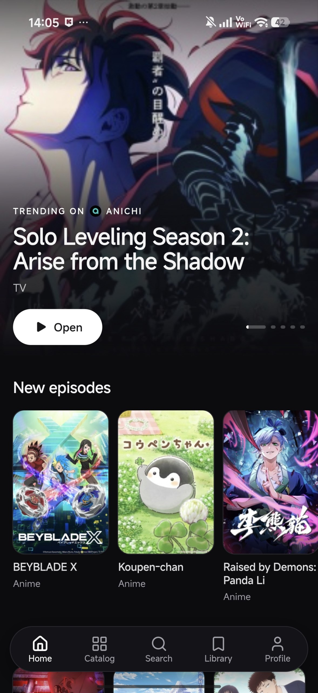
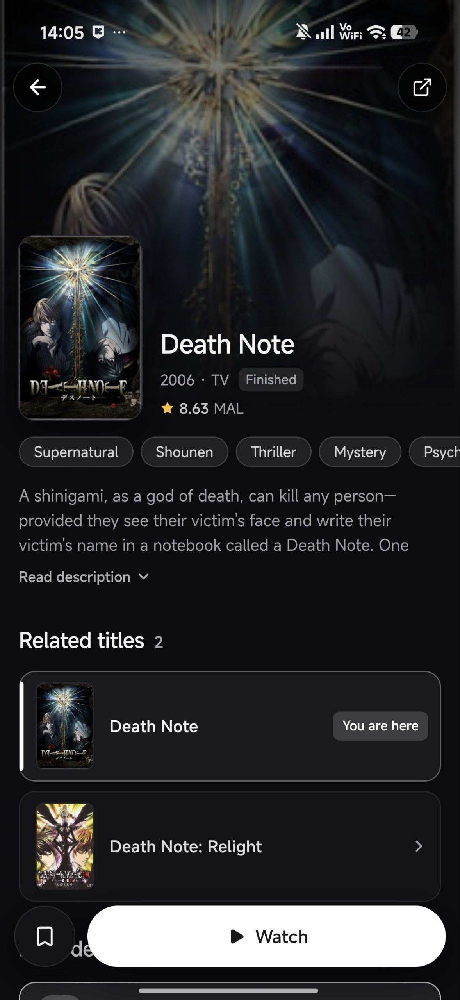
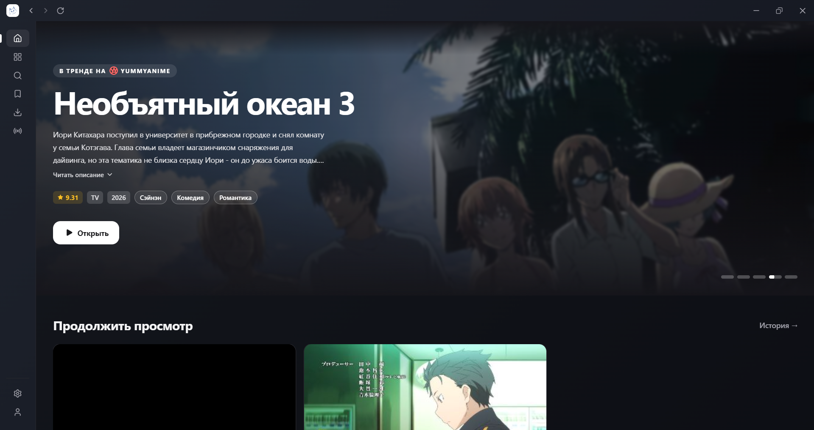
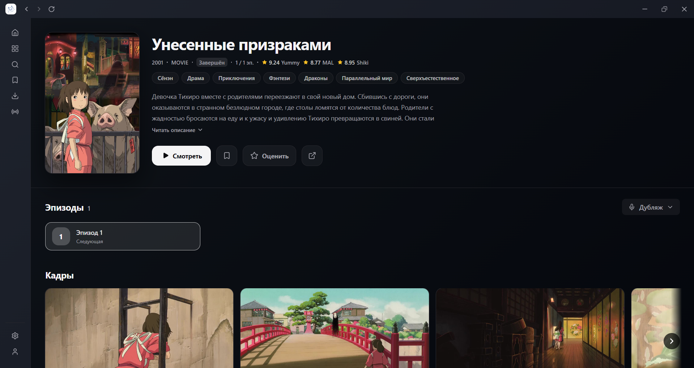

<div align="center">

  

  # hibiki

  [English](README.md)

  **hibiki — аниме-клиент для поиска тайтлов, ведения личной библиотеки и просмотра серий с сохранением прогресса. Источники подключаются через внешние репозитории; приложение не хранит и не распространяет контент.**

  [](LICENSE)

</div>

### 📚 Основные возможности

* Каталог аниме из выбранных источников с поиском, фильтрами и сортировкой
* Подключение внешних репозиториев источников и управление расширениями ([hibiki-sources](https://github.com/akkirrai1337/hibiki-sources))
* Подробные страницы тайтлов с описанием, жанрами, связанными и похожими аниме
* Выбор серии и озвучки, настройка качества и скорости воспроизведения
* Встроенный плеер с поддержкой HLS, DASH и MP4, автопереходом и пропуском опенинга/эндинга
* Сохранение прогресса, продолжение просмотра, история и статистика просмотров
* Локальная библиотека: смотрю, в планах, просмотрено, брошено, отложено и избранное
* Загрузка серий для офлайн-просмотра
* Настройка оформления и языка интерфейса, опциональный Discord Rich Presence

### 📥 Установка

Скачать можно на странице [Releases](https://github.com/akkirrai1337/hibiki/releases), либо:

* **Windows**: запустите `hibiki-v…-setup.exe`.
* **Android**: установите `hibiki-v….apk`.
* **macOS** и **Linux**, одной командой:

  ```sh
  curl -fsSL https://raw.githubusercontent.com/akkirrai1337/hibiki/main/scripts/install.sh | sh
  ```

  Скрипт сам выберет сборку под вашу систему (macOS Apple Silicon или Intel, Linux x64), сверит её с контрольной суммой релиза и установит: `hibiki.app` в `/Applications` либо AppImage как `~/.local/bin/hibiki` с записью в меню. Для AppImage на Linux нужен FUSE 2 (`sudo apt install libfuse2` в Debian/Ubuntu).

  **macOS и Gatekeeper.** Приложение не подписано сертификатом Apple Developer, поэтому скачанную в браузере копию система блокирует при первом запуске. Установка командой выше этого избегает. Если вы поставили из `.dmg`: перетащите приложение в «Программы» и один раз выполните `xattr -cr /Applications/hibiki.app` (или в macOS 15 разрешите запуск в «Системные настройки → Конфиденциальность и безопасность» кнопкой «Всё равно открыть»).

Обновления предлагаются внутри приложения. На Windows запускается новый установщик, на macOS и Linux приложение подменяет себя само и перезапускается (если оно лежит в папке, куда вы не можете писать, откроется страница релиза).

### 🖼️ Скриншоты


<div align="center">

<h4>Android</h4>

<table>
  <tr>
    <td></td>
    <td></td>
  </tr>
</table>

<h4>ПК</h4>

<table>
  <tr>
    <td></td>
    <td></td>
  </tr>
</table>

</div>

### 🎬 Credits

- [Anikku](https://github.com/komikku-app/anikku) и [Yuzono anime-extensions](https://github.com/yuzono/anime-extensions): API расширений Aniyomi и код совместимости, используются по лицензии Apache-2.0.

### 💬 Связь

По вопросам, предложениям или баг-репортам можно написать мне в Discord: `akkirrai`

### 📄 Лицензия

hibiki распространяется под лицензией [GNU General Public License v3.0](LICENSE).

### ⚖️ DMCA Disclaimer

Разработчик этого приложения не аффилирован с контентом, доступным в приложении, и не хранит и не распространяет этот контент. Приложение следует рассматривать как веб-браузер: всё содержимое, доступное через него, свободно доступно в интернете. Все запросы на удаление контента по DMCA следует направлять владельцам сайта, на котором этот контент размещён.
